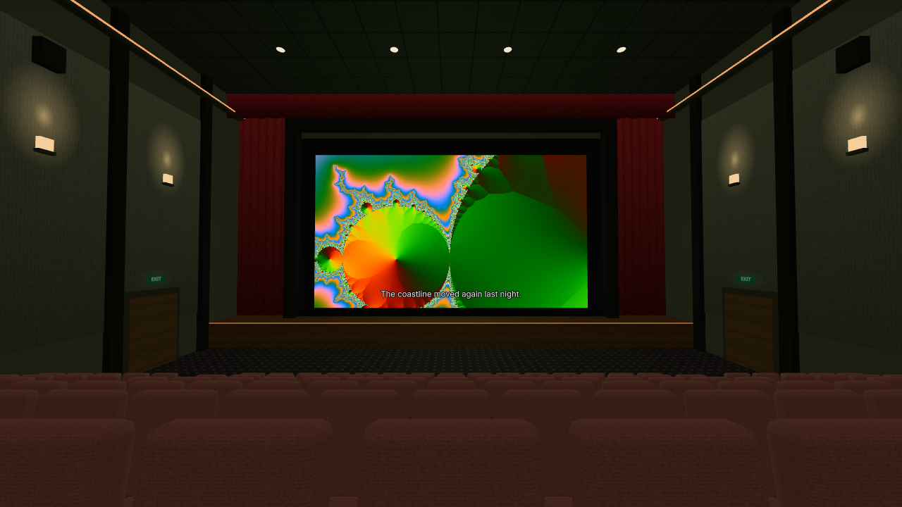
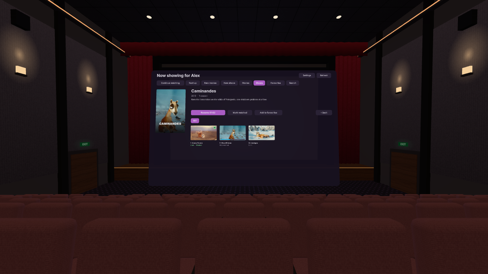
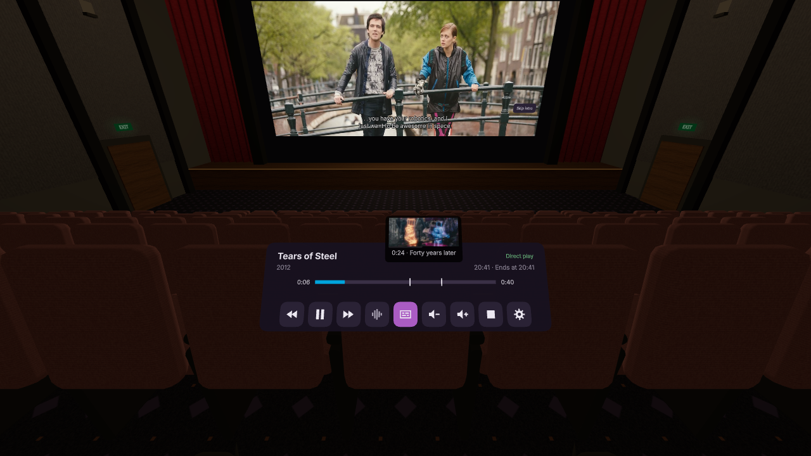
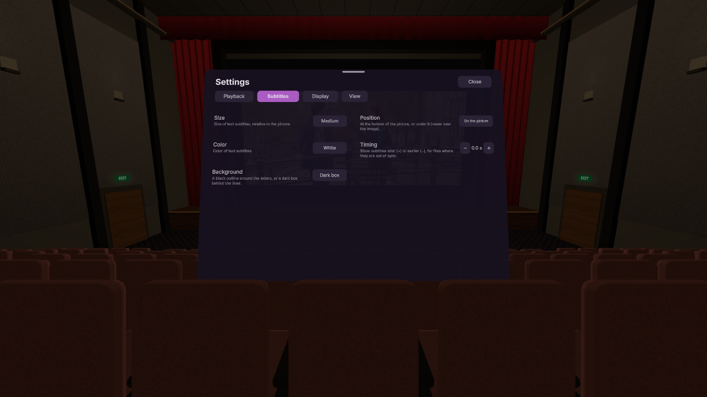

# JellyTheatre

**Your [Jellyfin](https://jellyfin.org) library on a giant screen, in VR.**

JellyTheatre lets you watch your own films and shows on a Meta Quest 3 (or
another WebXR headset). You pick a place to watch from: a movie theatre, a
cosy home cinema, a space station, a cabin by a lake, or your own room. It
runs in the headset's browser and installs like an app. There is nothing to
sideload and nothing to add to your server.

## Features

### Places to watch

| | |
|---|---|
|  |  |
| **Movie theatre**: stadium seating, curtains, a projection booth and a giant screen. | **Home cinema**: recliners, a sofa, bookshelves and a starry ceiling. |
|  |  |
| **Space station**: float in a Cupola like the ISS's, windows all around onto the planet, the moon and the stars. | **Lakeside cabin**: a crackling fire, rain on the windows, a moonlit lake. |

You can also watch in a **Dark void** (only the screen), or in **My room**,
which uses passthrough to put the screen in your real room, where you can move
it. Room lighting follows the colours of the picture, so the room glows blue
during a night scene and warm during a sunset. You can turn this off or change
the room's brightness.

### Your library, in sync

- **Continue watching**, **Next up**, **New movies** and **New shows**, right
  on the big screen.
- **Browse everything**: all movies and shows, sorted and filtered (by genre,
  or hiding what you've already watched). There are also favourites and a
  search with an on-screen keyboard.
- **Series pages** have season tabs, episodes with their watched status, and
  "play next".
- **Always in sync with Jellyfin**: playback resumes where you stopped (even if
  you started on another device), and your progress, watched status and
  favourites are saved back to your server.

| | |
|---|---|
|  |  |

### Gentle on your server

JellyTheatre plays your files **as they are** whenever the headset can decode
them (H.264, HEVC, VP9 and AV1 included). If the headset can't, the server
only repackages the file or converts the audio, which is cheap. A full
transcode happens only as a last resort. Each poster shows the quality
(4K, HDR…) and whether the file will play directly. A film's page also shows
the server's decision before you press Play.

### Made for watching

- **Subtitles**: text subtitles (SRT, ASS, WebVTT…) and Blu-ray image
  subtitles (PGS) are drawn by the headset, so the server never burns them in.
  You can change their size, colour, outline or background box, and where they
  appear (on or below the picture). You can also shift their timing when they
  are out of sync, right from the subtitle menu.
- **Skip intro / credits** button, or automatic skipping (when your server
  detects intros and credits).
- **Seek bar previews** (thumbnails) and **chapter marks**.
- **Up next**: when the credits start, the next episode is offered with a
  countdown. You can cancel it in one click or turn autoplay off.
- **Audio and subtitle track menus**, and volume up to 150 %.
- **The time, and when the film ends**, on the controls (there's no clock in VR).
- **Crisp picture and menus**: on the Quest, the video and menus are drawn
  directly by the headset at full resolution.

| | |
|---|---|
|  |  |

### Comfortable in VR

- **Change seats** by pointing at one and teleporting there (no walking, no
  motion sickness), plus **snap turn**.
- **Recenter** with the Quest's own button. If you're reclined, the screen
  stays in front of you.
- **Adjustable eye height**, if your seat feels too low or too high, or if you
  watch lying down.
- The **library, controls and settings panels can be grabbed and moved**
  wherever you like.

## Getting started

1. Your Jellyfin server must be reachable over **HTTPS** (browsers don't allow
   a secure page to load video from a plain HTTP server, and VR requires a
   secure page).
2. On the headset, open **https://jellytheatre.vpelloin.eu/** in the
   Quest Browser. To install it as an app, use the browser's menu.
3. Enter your server address and sign in. **Quick Connect** is easiest: enter
   the code shown in JellyTheatre in another Jellyfin app (phone, web), with
   no typing in VR. Username and password also work.
4. Press **Enter VR**, and pick a film.

### Controls

| | |
|---|---|
| Trigger | Point and click |
| A / X | Play / pause |
| B / Y | Show / hide the controls |
| Grip (on a panel) | Grab and move it; push or pull the stick to move it farther or closer |
| Stick forward, point at a seat, release | Teleport to that seat |
| Right stick left / right | Snap turn |
| Left stick click | Back to your seat |
| Hold the Meta button | Recenter the view |

Settings open from the library's header, or from the gear on the controls
during a film. They are grouped in tabs: Playback, Subtitles, Display and
View.

## Roadmap

Ideas for future versions:

- **3D films**: play side-by-side and top-bottom 3D files in true stereo.
- **Spatial audio and room acoustics**: sound that comes from the screen, with
  a reverb that matches the room (a big theatre, a small home cinema, a cosy
  cabin).
- **Hand tracking**: point and pinch instead of using controllers, including
  gestures for teleport and recenter.

Suggestions are welcome in the issues.

## For developers

Architecture, how Jellyfin is used, the playback strategy, development setup,
testing on the Quest and deployment are in
[docs/TECHNICAL.md](docs/TECHNICAL.md).

## Credits

The films in the screenshots are open movies by the
[Blender Foundation / Blender Studio](https://studio.blender.org/films/),
released under Creative Commons Attribution licences (CC BY 2.5, 3.0 or 4.0):
*Sintel*, *Tears of Steel*, *Big Buck Bunny*, *Spring*, *Sprite Fright*,
*Charge*, *Cosmos Laundromat*, *Elephants Dream*, *Coffee Run*, *Wing It!*,
*Hero*, *Glass Half* and *Caminandes*. Posters and footage come from
[Wikimedia Commons](https://commons.wikimedia.org). Some posters were made from a
still of the film with its title added, and the clip that plays is silent.

## License

See [LICENSE](LICENSE).
