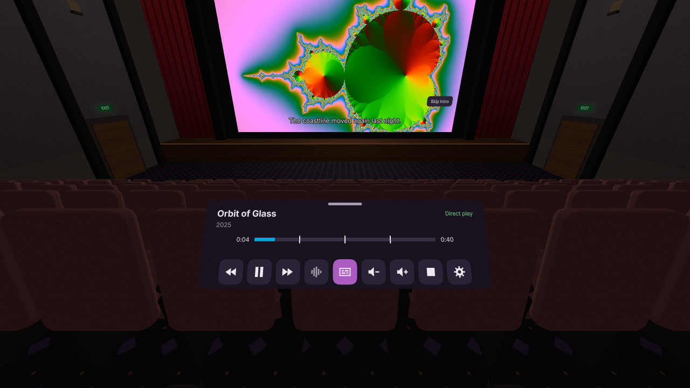
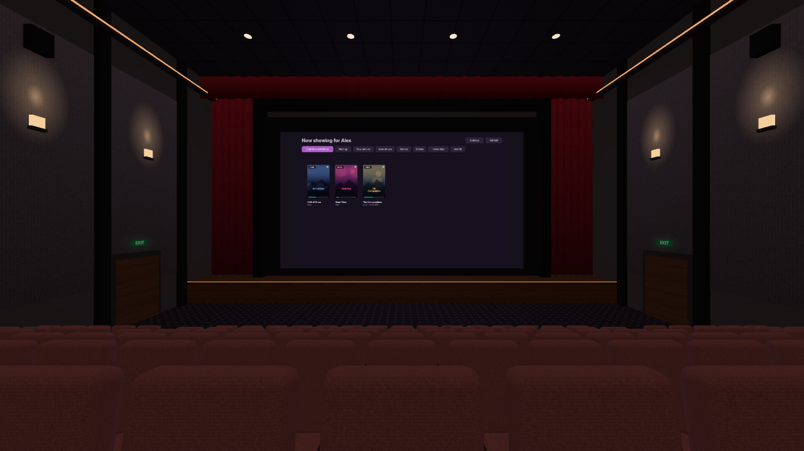
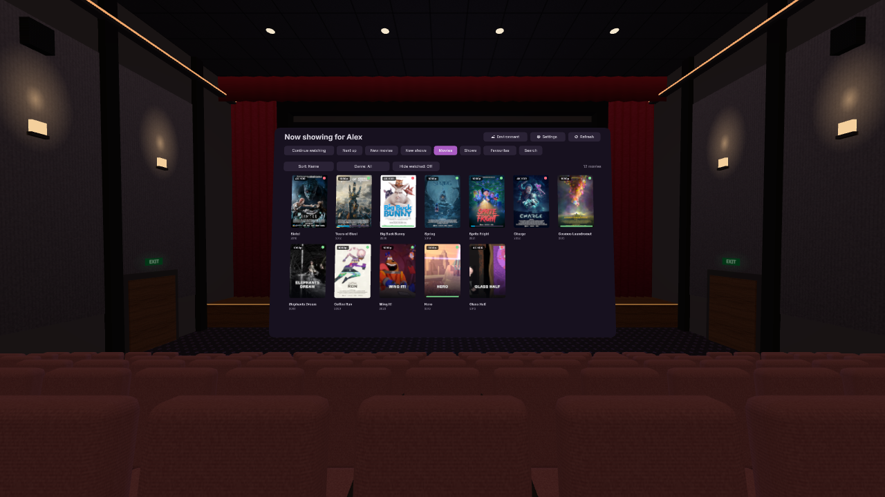
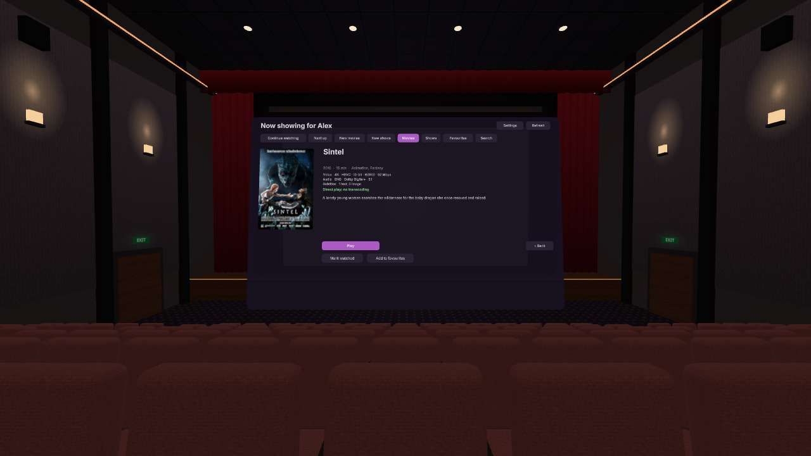
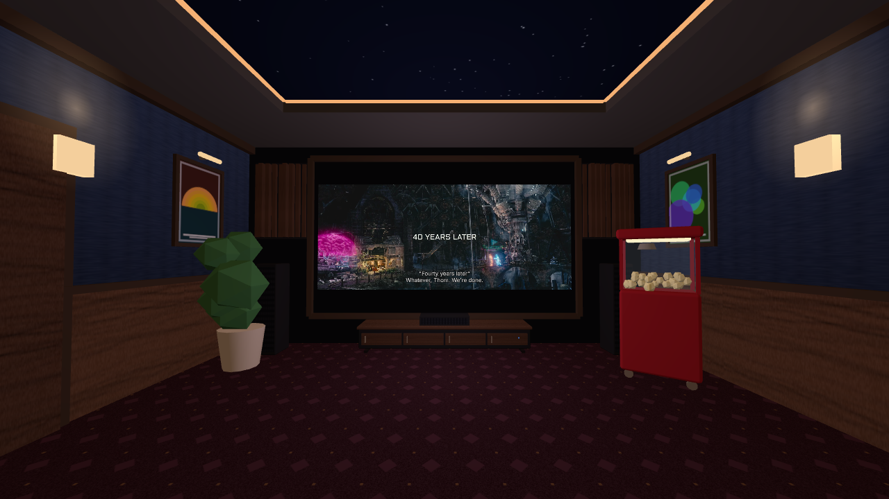
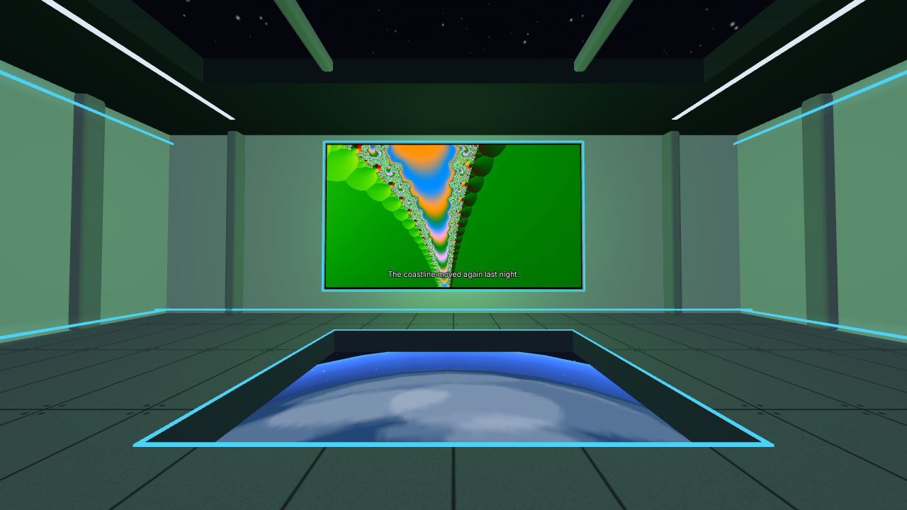
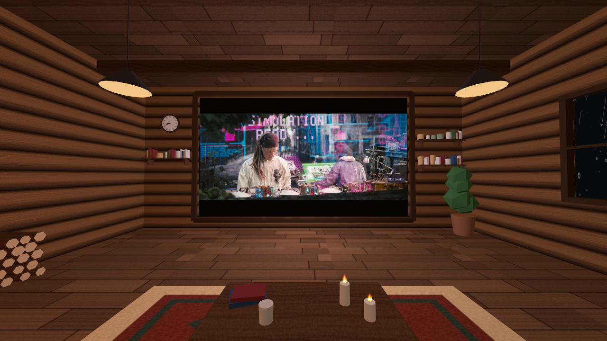
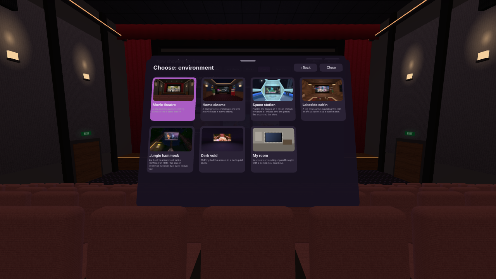

# JellyTheatre

A WebXR client for [Jellyfin](https://jellyfin.org): watch your movies and shows in
a virtual movie theatre on a VR headset (primary target: **Meta Quest 3** via the
Quest Browser). It is an installable PWA built with [A-Frame](https://aframe.io).

## Screenshots

| | |
|---|---|
|  |  |
|  |  |
|  |  |
|  |  |

The screenshots (and the environment picker's pictures) are generated against
a fake Jellyfin server with invented films: `npm run screenshots` (needs Chrome
or Chromium, `CHROME_PATH` if not found, and ffmpeg for the film shots).

## Goals

- **Environments**: the video is shown inside a 3D environment. First one: a simple
  movie theatre. More (and a passthrough "screen in your room" mode) later.
- **Library sync**: show what you are currently watching (Continue Watching,
  Next Up), resume where you left off, and report progress back so Jellyfin stays
  the single source of truth for watch state.
- **Subtitles**: text subtitles (SRT, ASS/SSA, WebVTT…) rendered in the scene.
- **Avoid transcoding**: the target server is low-powered. Direct play whenever
  the headset can decode the file, cheap remux/audio-only transcode otherwise,
  full video transcode only as a last resort.

## Approach: Jellyfin API, not the Jellyfin web UI

Embedding the Jellyfin web interface was considered and rejected: inside an
immersive WebXR session only WebGL output is visible, and a cross-origin web page
(iframe/DOM) cannot be rendered into a WebGL texture. JellyTheatre therefore talks
to the Jellyfin REST API directly (through `@jellyfin/sdk`) and draws its own UI.

JellyTheatre is **standalone**: everything (browsing, search, playback,
settings) happens inside the headset. It is not a remote-control target for the
official Jellyfin apps.

### Jellyfin API usage

| Need | Endpoint |
|---|---|
| Login without a keyboard | Quick Connect: `POST /QuickConnect/Initiate`, poll `GET /QuickConnect/Connect`, then `POST /Users/AuthenticateWithQuickConnect`. Password login as fallback. |
| Currently watching | `GET /UserItems/Resume`, `GET /Shows/NextUp` |
| Browse | `GET /UserViews`, `GET /Items?ParentId=…` |
| Resume position | `UserData.PlaybackPositionTicks` on items |
| Stream selection | `POST /Items/{id}/PlaybackInfo` with a device profile describing the headset |
| Progress sync | `POST /Sessions/Playing`, `/Sessions/Playing/Progress` (≈10 s + on pause/seek), `/Sessions/Playing/Stopped` |
| Subtitles | `DeliveryUrl` of external subtitle streams (WebVTT) |

### Playback strategy (minimising server load)

The device profile sent to `PlaybackInfo` is built **at runtime** from what the
browser reports (`MediaSource.isTypeSupported` / `canPlayType`), so we never
claim support we don't have, and never under-claim what the Quest can decode
(H.264, HEVC, VP9, AV1 in hardware). Preference order:

1. **Direct play**: the original file is streamed as-is. Zero server CPU.
2. **Direct stream / remux**: the video is copied into HLS (e.g. H.264/HEVC in
   MKV, which Chromium cannot demux), audio copied or transcoded (AC3/DTS → AAC
   is cheap). Very low server CPU.
3. **Full transcode**: only if the video codec itself is unsupported.

Subtitles must never force a transcode: text subtitles are requested with
`External` delivery (converted to WebVTT by the server, which is cheap) and
rendered by the client. PGS image subtitles are also delivered as-is and drawn
by the client (libpgs). Other image formats (VobSub/DVB) would require burn-in,
so they are not offered.

### Constraints

- **HTTPS everywhere**: WebXR and service workers need a secure context, and an
  HTTPS page cannot load media from an HTTP Jellyfin server. Your Jellyfin server
  must be reachable over HTTPS (or everything on `localhost` during development).
- Jellyfin sends permissive CORS headers by default, which is required to use the
  video as a WebGL texture.

## Development

Requires Node ≥ 20.

```sh
npm install
npm run dev        # http://localhost:5173
npm run dev:https  # self-signed HTTPS, to open from the headset over the LAN
npm run build      # production build in dist/
```

### Testing on the Quest 3

WebXR (and the PWA service worker) only work in a **secure context**: a page
served over HTTPS, or from `localhost`. A page opened over plain HTTP on a LAN
address (`http://192.168.x.x`) can't enter VR, so the dev server must use HTTPS:

```sh
npm run dev:https       # dev server, live reload
npm run build && npm run preview:https   # or: test the production build (PWA included)
```

Then open `https://<your-pc-ip>:5173` (dev) or `:4173` (preview) in the Quest
Browser and accept the self-signed certificate warning. The Quest must be on the
same network as your PC. Any static HTTPS server pointed at `dist/` works too.

Optional alternative without certificates: with the headset connected over USB
(developer mode), `adb reverse tcp:5173 tcp:5173` lets the Quest open
`http://localhost:5173`, which counts as secure.

On desktop, Meta's *Immersive Web Emulator* browser extension can emulate a Quest.

## Testing and deployment

```sh
npm run build && npm test   # ~10 s end-to-end smoke test (headless Chrome, fake Jellyfin)
```

Every push to `main` is built, tested and published to GitHub Pages by
`.github/workflows/pages.yml` (pull requests are built and tested only). The
app is then served at `https://<owner>.github.io/<repository>/` and can be
installed from there as a PWA. One-time setup: in the repository's
*Settings → Pages*, set *Source* to *GitHub Actions*.

To build for another sub-path: `BASE_PATH=/some/path/ npm run build`.

## Project layout

```
index.html            Single page: 2D lobby overlay + A-Frame scene
src/
  main.js             Entry point, wires lobby, scene and app state
  jellyfin/           API client, auth (Quick Connect), playback, reporting, library
  player/             Player (direct / HLS), screen component, controller input
  ui/                 In-VR UI components (panels, buttons, poster grid, seek bar)
  environments/       Environment registry + environments (theater, …)
  lobby/              2D (non-VR) lobby: server, login, enter VR
public/               Static assets (icons…)
```

## Roadmap

- [x] **0. Docs**: this README and `CLAUDE.md`.
- [x] **1. Scaffold**: Vite + A-Frame + PWA, HTTPS / adb dev workflow, empty
      scene running on the Quest.
- [x] **2. Auth & lobby**: server URL, Quick Connect + password login, session
      persisted in `localStorage`, usable without a headset.
- [x] **3. Theatre & player**: procedural theatre (instanced seats, dimming
      house lights), "Now showing" panel (Continue watching / Next up / Recently
      added), PlaybackInfo with a runtime device profile → direct play or HLS
      remux → video texture, controls (play/pause, seek bar, −10 s / +30 s,
      volume, audio and subtitle menus, playback mode badge), text subtitles
      rendered on the screen, progress reporting (start / progress / stopped).
- [x] **4. Library browsing**
  - [x] Tabs: Continue watching, Next up, New movies, New shows, Movies and
        Shows (whole collection, sortable, paged), Search (on-screen keyboard
        or physical keyboard).
  - [x] Details view (Resume / Play from start), series view (seasons,
        episodes with watched status, play next).
  - [x] Mark watched / unwatched, favourites (+ Favourites tab), genre and
        unwatched filters.
  - [x] "Up next" prompt when the credits start (needs media segments on the
        server) or at the end: 10 s auto-play countdown, one-click Cancel or
        "Turn off auto-play". Media versions picker.
  - [x] In-VR settings page (Settings button in the library panel header).
  - [x] Season tabs with short labels (S01, Specials) that scroll with ‹ ›.
  - [x] Library shown on the cinema screen (or close to the seat, setting).
  - [x] Compact icon controls panel, movable with the grip button.
- [x] **Library as a compositor layer** in VR (crisp text), with in-scene
      fallback (setting). Volume through Web Audio (up to 150 %).
- [x] **Rendering**: 72 Hz (3 × 24 fps film cadence), optional 1.25× resolution
      without foveation for sharper menus; hls.js retries and recovery for slow
      remux starts.
- [x] **WebXR media layer**: in VR on Quest, the video is a compositor layer
      behind the scene (much sharper), with a texture fallback elsewhere.
- [x] **5. Polish**
  - [x] View: teleport (push a stick forward to aim, release to jump; snaps
        to theatre seats), snap turn (right stick), recenter that compensates
        automatically when reclined (on the headset's own recenter: hold the
        Meta button), back to seat (left stick click). In passthrough, the screen can be grabbed and moved.
  - [x] Room brightness and screen light settings. Settings on their own movable panel, reachable
        anytime (library header, or the gear on the controls during a film).
  - [x] Media quality and compatibility in menus: resolution / HDR badges and
        a direct play / remux / transcode indicator on posters; full details
        and the server's decision (with reasons) on the details page.
  - [x] Room lighting that follows the colours on screen.
  - [x] Environment kit (src/environments/kit/): reusable textures,
        geometry, merged static builder, instanced seating and lighting.
  - [x] Theatre rebuilt with the kit: stadium seating in three blocks, lit
        aisle steps, acoustic wall bays with sconces and surround speakers,
        stage, proscenium and folded curtains, exit doors, lit ceiling,
        projection booth with a beam that takes the picture's colour.
  - [x] Home cinema (recliners, sofa on a riser, star ceiling, bookshelves),
        space station (observation deck over a turning planet) and lakeside
        cabin (fireplace with a real fire, rain on the windows, moonlit lake).
  - [x] Environment picker: illustrated cards in Settings.
  - [x] Environments: theatre, dark void, passthrough ("My room", an
        immersive-ar session with the screen in your real room).
  - [x] Image subtitles (PGS) rendered client-side (libpgs), never burned in.

## License

See [LICENSE](LICENSE).
